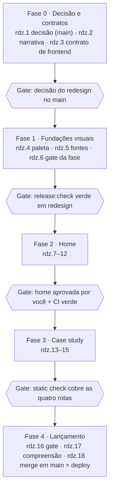

# Yumusarái Labs — roadmap do redesign

20 out 2026 · Bruno Guide · cópia de trabalho do doc "Yumusarái Labs — roadmap do redesign" (Claude Docs)

> **Fonte de status = beads** (épico do redesign). Este arquivo é o plano: muda por PR
> quando o escopo muda, não a cada bead fechada. Referência visual em `design/`.

## Ponto de partida e alvo

A maior parte do redesign é apresentação e entra direto; treze pontos esbarram em contratos congelados do repositório e precisam de uma decisão do redesign antes de qualquer código. O número dela é o próximo livre em `decisions-log.md` no merge da rdz.1: D073 (#173) e D074 (#178) entraram no `main` em 3 nov 2026, então será D075 se nenhuma outra decisão entrar antes. O alvo são as telas em `design/` (home + página de bastidores), e o ponto de partida é `main` em `f6c21c8`.

O repo já protege o que importa: `docs/public-experience-narrative.md` congela tese, nav e CTAs; `docs/frontend-agent-contract.md` define o que cada bead pode tocar; `web/scripts/check-static-output.mjs` e os e2e quebram o build se o texto sair do combinado.

| Mudança do redesign | Regra que ela toca | Recomendação |
| --- | --- | --- |
| Paleta grafite/vinho/ameixa | `styles/tokens.css` (transversal); snapshots visuais §5 | Fazer. Trocar os tokens, não as classes; regenerar snapshots nos dois SOs |
| Bricolage Grotesque + JetBrains Mono | Fontes são Conditional (`layout.tsx`, `package.json`); orçamento de LCP 2.500 ms | Fazer via `@fontsource-variable/*` local, como o Inter já é. Nunca Google Fonts |
| Novo h1 "Can 32 numbers recognise a footballer?" | `check-static-output.mjs` exige "A player leaves a reproducible fingerprint"; `9a3.14` exige as duas metades no h1 | Emendar via a decisão do redesign; o novo h1 ou a linha logo abaixo precisa citar as duas metades da temporada |
| Hero sem tese e sem boundary | D066: tese + boundary verbatim e adjacentes no hero | Não fazer. `ThesisStatement` entra logo abaixo do h1, no lugar do lead do desenho |
| Nav "The idea / A fingerprint / What we found / How I built it" | §6.1 congela Overview · Fingerprint Lab · How it works | Manter os três rótulos; adicionar só "Case study" como quarto item (decisão do redesign) |
| CTAs "Find a player in the Lab" / "See how I built it" | §6.3 congela "Explore every fingerprint" + secundário para /science | Manter os rótulos congelados; o case study ganha um bloco próprio mais abaixo |
| Números digitados no HTML (0.254, #1 de 1.257…) | "No result values in copy"; e2e `rendered-values` e `claims-consistency` | Todo número sai de `research-summary.json` / artefatos do Lab via `requireMetric` |
| "About 10× better than guessing" | Número derivado que não existe em nenhum artefato | Cortar, ou publicar a razão no pipeline antes de exibi-la |
| Faixa "100% open, reproducible results" | Afirmação sem evidence ID | Trocar por fato do manifest (licença CC BY 4.0, dataset pin) |
| Página "How I built it" | §6.1: "no separate /about route is added" | Criar `/case-study/` via a decisão do redesign, com conteúdo de `docs/case-study.md` |
| Rota, camada CSS e componente novos | `frontend-agent-contract.md` §2/§4: o que não está listado é Denied | Emendar o contrato na fase 0 (rdz.3) antes de qualquer bead criar arquivo novo |
| Snapshots regenerados numa bead à parte | Contrato §5.1: baseline só muda na bead cujo diff causou a mudança; o CI roda os e2e visuais em todo PR | Cada bead que move pixel regenera os próprios baselines, nos dois SOs, no mesmo PR |
| Seção "What AI did" (reescrever copy) | `case-study.md` §7: não há IA no site publicado | Reescrever: IA como equipe de engenharia governada (agentes + beads + contratos) e o toolkit offline fail-closed |

Identidade: as telas em `design/` usam "Player Fingerprints" sob o wordmark, mas `public-identity-contract.md` congela o descritor "Player Fingerprint Lab". Use o descritor congelado.

## Como o redesign vai ao ar

Todo merge no `main` publica o site: o workflow `deploy` roda quando o `quality` passa no `main`. Para o site não ir ao ar pela metade (paleta nova com layout velho, link para uma `/case-study/` que ainda não existe), o redesign é montado num branch de integração, `redesign`, e vai ao ar de uma vez.

- `docs/redesign/**` e a rdz.1 (a decisão) entram direto no `main`. São só documentos e fixam o número da decisão antes que outro branch o tome.
- Da rdz.2 em diante, cada bead sai de `redesign` num branch `bd/scoutlens-rdz.N` e abre PR para `redesign`. O CI roda igual, porque `tests.yml` dispara em `pull_request` para qualquer base (`release:check` completo e a guarda de pares de baseline). O deploy não roda, porque só olha o `main`.
- O `main` entra em `redesign` por merge, nunca rebase, quando outro trabalho chegar ao `main`. Isso acontece sempre antes da rdz.8 (a landing é o arquivo mais disputado) e antes da rdz.16. O trabalho da landing que estava em andamento (`scoutlens-9a3.32`, `scoutlens-uze.32`) entrou no `main` em 3 nov 2026, antes de `redesign` existir.
- A rdz.18 é o PR `redesign` → `main`. O merge dele é o deploy.

## Como trabalhar com o Claude Code

Cada item do roadmap vira uma bead, e cada bead roda numa sessão com o mesmo prompt-base. O protocolo já existe (`frontend-agent-contract.md` §3): uma bead, um branch, um PR, gates citados com a saída real.

- **Épico novo** no beads ("Redesign Yumusarái Labs") com uma bead por linha da tabela de fases. Labels `frontend` ou `product-narrative`; `delegable` só nas que não mexem em texto congelado.
- **Desenho é referência, não código.** As telas em `design/*.png` mostram a intenção; os `*.dc.html` trazem números digitados e estilos inline que os testes rejeitam. Reproduzir com os componentes existentes.
- **Sessões curtas.** Uma bead por sessão.
- **Você revisa o que é texto.** Beads `product-narrative` passam por você antes do merge; as `frontend` podem ir para o revisor automatizado.
- **Antes de commitar:** `pnpm quality` dentro de `web/`. Antes de cada gate de fase: `pnpm release:check`.
- **Bead que move pixel leva os próprios baselines.** O CI roda `release:check` completo em todo PR, então o PR só passa com os snapshots que o diff dele move regenerados (contrato §5: Linux no container do CI e Windows, no mesmo PR, com a lista de diferenças pretendidas e as imagens antes/depois).

Prompt-base para cada sessão (troque o id):

```markdown
Você vai executar a bead <ID> do épico do redesign.

0. Branch: `git switch redesign && git switch -c bd/<ID>`; o PR vai para `redesign`
   (só a rdz.1 sai do `main` e volta para o `main`).
1. Leia antes de tocar em código: `bd show <ID>`, docs/redesign/ROADMAP.md,
   docs/frontend-agent-contract.md, docs/public-experience-narrative.md,
   docs/decisions-log.md (D066 em diante, incluindo a decisão do redesign).
2. Referência visual: docs/redesign/design/*.png. Reproduza a intenção com os
   componentes existentes; não copie HTML, estilos inline nem números do desenho.
3. Todo número vem de artefato (requireMetric / showcase loaders). Nenhum valor digitado.
4. Tese, boundary, caveats e claims são intocáveis. Se o layout não couber, pare e reporte.
5. Toque só nos arquivos que a bead nomeia. Se precisar de um arquivo Denied, pare.
6. Rode em web/: pnpm quality; se a bead move pixel, regenere os baselines dela (contrato §5)
   e rode pnpm release:check. Cole a saída real no handoff.
7. Mostre o diff e os comandos de commit propostos; não faça commit nem push sem eu autorizar.
```

## Fases e beads



| Fase | Beads | Gate para seguir |
| --- | --- | --- |
| 0 · Decisão e contratos | rdz.1–3 | Decisão do redesign no `main`; narrativa e contrato emendados em `redesign` |
| 1 · Fundações visuais | rdz.4–6 | rdz.6: `pnpm release:check` verde em `redesign` com o visual novo |
| 2 · Home | rdz.7–12 (7, 8 e 11 em paralelo) | Home aprovada por você + CI verde |
| 3 · Case study | rdz.13–15 | Static check cobre as quatro rotas |
| 4 · Lançamento | rdz.16–18 | — |

Dependências no beads: cada bead da fase N depende de todas as da fase N−1. Dentro das fases, a ordem segue os arquivos compartilhados (contrato §3.2) e a lógica do trabalho:

- **Fase 0:** a rdz.2 e a rdz.3 vêm depois da rdz.1.
- **Fase 1:** a rdz.6 vem depois da rdz.4 e da rdz.5.
- **Fase 2:** a rdz.9 vem depois da rdz.8 e a rdz.12 depois da rdz.9, porque as três mexem em `page.tsx` e `landing.css`. A rdz.10 vem depois da rdz.11, porque as duas mexem em `research-story`.
- **Fase 3:** a rdz.14 vem depois da rdz.13, e a rdz.15 depois da rdz.13 e da rdz.14.
- **Fase 4:** a rdz.17 vem depois da rdz.16, e a rdz.18 depois da rdz.16 e da rdz.17.

| Bead | Fase | Labels | Arquivos | Pronta quando |
| --- | --- | --- | --- | --- |
| rdz.1 Registrar a decisão do redesign (escopo) | 0 | product-narrative | `docs/decisions-log.md` (PR para `main`) | A decisão, com o próximo número livre no merge, lista o que muda (h1, nav + Case study, rota `/case-study/`, paleta, fontes, branch `redesign`) e o que segue congelado |
| rdz.2 Emendar a narrativa pública | 0 | product-narrative | `docs/public-experience-narrative.md` §6.1, §6.2, §7.1 | Nenhuma frase contradiz a decisão do redesign; tese e boundary intactas |
| rdz.3 Emendar o contrato de frontend | 0 | frontend | `docs/frontend-agent-contract.md` §2, §4.1 | §2 lista `web/src/app/case-study/page.tsx` e o componente do hero, e nomeia rdz.8, rdz.13 e rdz.15 como exceções para `web/scripts/check-static-output.mjs`; §4.1 ganha `styles/case-study.css` como camada 9 |
| rdz.4 Paleta nova nos tokens | 1 | frontend, delegable | `styles/tokens.css` + baselines que ela move | Contraste anotado em cada token (≥ 4,5:1 para texto); `css-custom-properties` verde; baselines no mesmo PR (§5) |
| rdz.5 Fontes de display e mono | 1 | frontend | `package.json`, `pnpm-lock.yaml`, `layout.tsx`, `styles/base.css` + baselines | `@fontsource` local; peso e alternativa rejeitada na bead; Lighthouse ≥ 0,9 e LCP ≤ 2.500 ms; baselines no mesmo PR |
| rdz.6 Gate da fase 1 | 1 | frontend | — | `pnpm release:check` verde em `redesign`; diffs de baseline da rdz.4 e da rdz.5 lidos nos dois SOs; contraste conferido nos fundos claro, grafite e ameixa |
| rdz.7 Header e footer novos | 2 | frontend, delegable | `site-header.tsx`, `site-footer.tsx`, `styles/shell.css` | Nav com 4 itens; descritor "Player Fingerprint Lab"; `public-identity` verde |
| rdz.8 Hero com cartão-prova | 2 | frontend, product-narrative | `app/page.tsx`, `styles/landing.css`, componente nomeado na rdz.3, `check-static-output.mjs` | Novo h1 + `ThesisStatement` adjacente; ranks do perfil em destaque lidos do artefato; CTAs congelados; static check espera o novo h1 no mesmo PR |
| rdz.9 Faixa de fatos + "a ideia em 30 segundos" | 2 | product-narrative | `app/page.tsx`, `styles/landing.css` | Fatos do manifest; copy aprovada por você |
| rdz.10 Fingerprint preview restilizado | 2 | frontend, delegable | `research-story.tsx`, `styles/research-story.css` | Halteres A/B; nomes oficiais das famílias mantidos; ordem do artefato |
| rdz.11 Evidência como história em 4 testes | 2 | frontend | `research-story.tsx`, `styles/research-story.css` | Escala 0–1; valores via `requireMetric`; caveat do confound dentro do cartão |
| rdz.12 Bloco "Behind the project" | 2 | product-narrative | `app/page.tsx`, `styles/landing.css` | Liga para `/case-study/`; sem afirmações fora de `case-study.md` |
| rdz.13 Rota `/case-study/` com a trilha de pesquisa | 3 | frontend, product-narrative | `app/case-study/page.tsx`, `styles/case-study.css` (nova camada no §4) | Seis decisões com números dos artefatos e links para os docs |
| rdz.14 Seção "IA governada" | 3 | product-narrative | idem | Só afirma o que `case-study.md` §7 e o workflow de agentes sustentam |
| rdz.15 Testes da nova rota | 3 | frontend | `e2e/**`, `check-static-output.mjs` | Landmarks, h1 único, "not current scouting information", marcadores de proveniência |
| rdz.16 Gate completo | 4 | frontend | — | `pnpm release:check` verde; axe sem violações |
| rdz.17 Teste de compreensão | 4 | product-narrative | `docs/public-understanding-check.md` | 3 leitores elegíveis (§2.2) respondem às 6 perguntas sobre o build de `redesign` (§2.1); corridas registradas no modelo do §5; cada achado do §4 vira bead de defeito filha do épico e bloqueia a rdz.18 |
| rdz.18 Merge em `main`, deploy e anúncio | 4 | — | — | PR `redesign` → `main` com CI verde; workflow `deploy` verde; site no ar; post do LinkedIn aponta para `/case-study/` |

A nova rota precisa cumprir o mesmo static check das outras três: um h1, os landmarks, o aviso "not current scouting information" e os marcadores de proveniência. Planeje isso no layout desde a rdz.13.

Toda bead que move pixel regenera os próprios baselines no mesmo PR. Não existe bead só para regenerar snapshot.

## Decisões que são suas

- [x] **Como vai ao ar.** Branch de integração `redesign`; a rdz.18 é o merge em `main` (20 out 2026).
- [x] **Ordem da fase 0 e da fase 1.** A rdz.3 vira a emenda do contrato de frontend (a expectativa do h1 vai para a rdz.8) e a rdz.6 vira o gate da fase 1 (20 out 2026).
- [x] **Texto final do h1.** "Can 32 numbers recognise a footballer?" + uma linha logo abaixo com as duas metades da temporada (3 nov 2026). O "32" é contagem de features e sai do artefato, não digitado.
- [x] **Quarto item da nav.** "Case study" no topo, como quarto item; emenda o §6.1 via a decisão do redesign (3 nov 2026).
- [ ] **História da IA.** Claude Code e agentes em paralelo via beads, contratos de agente e o toolkit de explicação offline. Nada além do que esses documentos sustentam.
- [ ] **Nomes simples das famílias** ("Keeping the ball" para Possession…). Subtítulo do nome oficial, ou de fora?
- [x] **Razão "~10×".** Cortar (3 nov 2026).
- [ ] **Links pessoais.** URL do LinkedIn e e-mail público.

## Checklist de lançamento

- [ ] `pnpm release:check` verde em `web/`
- [ ] Snapshots atualizados em Linux e Windows, diffs lidos
- [ ] Tese e boundary verbatim e adjacentes nas rotas que as exibem
- [ ] Nenhum número digitado: `rendered-values` e `claims-consistency` verdes
- [ ] Contraste conferido nos fundos claro, grafite e ameixa
- [ ] Páginas lidas no celular (360 px) e no desktop, inclusive `/case-study/`
- [ ] Teste de compreensão rodado e registrado (rdz.17), com cada achado do §4 resolvido
- [ ] `CHANGELOG.md` com a entrada do redesign e link para a decisão
- [ ] `redesign` mergeado em `main`, workflow `deploy` verde e post do LinkedIn publicado
